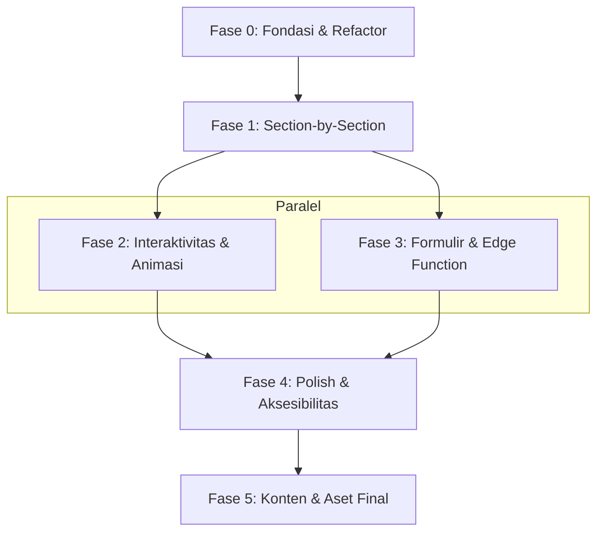

# Implementation Plan — Landing Page Kang Dimmy
**Berbasis spesifikasi `landing_kang_dimmy.md` v5.1 · 29 Oktober 2026**

| | |
|---|---|
| Stack | Next.js 16 · React 19 · Tailwind CSS 4 · TypeScript |
| Sumber kebenaran | `landing_kang_dimmy.md` v5.1 (spec), `design.md` v4.1 (design system) |
| Status saat ini | Satu file `page.tsx` monolitik, bahasa Inggris, belum ada section Portofolio, Konten, dan Sapa Saya (formulir + chip topik) |

---

## Daftar Isi

- [Fase 0 — Fondasi & Refactor](#fase-0--fondasi--refactor)
- [Fase 1 — Section-by-Section](#fase-1--section-by-section)
- [Fase 2 — Interaktivitas & Animasi](#fase-2--interaktivitas--animasi)
- [Fase 3 — Formulir, Edge Function & Data](#fase-3--formulir-edge-function--data)
- [Fase 4 — Polish, Aksesibilitas & Performa](#fase-4--polish-aksesibilitas--performa)
- [Fase 5 — Konten & Aset Final](#fase-5--konten--aset-final)
- [Gap Analysis: Spec vs Current Code](#gap-analysis-spec-vs-current-code)
- [Dependensi Antar Fase](#dependensi-antar-fase)

---

## Fase 0 — Fondasi & Refactor

> Tujuan: menyiapkan arsitektur komponen, token desain, dan bahasa Indonesia sebelum mengerjakan section per section.

### 0.1 Struktur Folder Komponen

```
app/
├── page.tsx                  ← compose semua section
├── layout.tsx                ← metadata, font, schema
├── globals.css               ← generated (tetap via generate-css.js)
├── components/
│   ├── ui/                   ← komponen atom
│   │   ├── Eyebrow.tsx
│   │   ├── SectionHeading.tsx
│   │   ├── Chip.tsx
│   │   ├── Button.tsx
│   │   ├── Card.tsx
│   │   ├── Timeline.tsx
│   │   ├── SocialIcon.tsx
│   │   └── Lightbox.tsx       ← BARU
│   ├── sections/              ← satu file per section
│   │   ├── Navbar.tsx
│   │   ├── Hero.tsx
│   │   ├── Sekilas.tsx
│   │   ├── Tentang.tsx
│   │   ├── Kerja.tsx
│   │   ├── Portofolio.tsx     ← BARU (video + galeri + tab peta jejak)
│   │   ├── Perjalanan.tsx
│   │   ├── Aktivitas.tsx
│   │   ├── Konten.tsx         ← BARU
│   │   ├── SapaSaya.tsx       ← BARU (formulir + chip topik)
│   │   └── Footer.tsx
│   └── hooks/
│       ├── useReveal.ts
│       └── useTimelineProgress.ts
├── data/
│   ├── experience.ts
│   ├── volunteering.ts
│   ├── education.ts
│   ├── portfolio-tabs.ts     ← BARU (data peta jejak 8 tab)
│   ├── activities.ts
│   └── channels.ts
└── lib/
    └── constants.ts           ← token warna, breakpoint, dsb.
```

| # | Task | Detail | Estimasi |
|---|---|---|---|
| 0.1 | Buat folder `components/ui`, `components/sections`, `components/hooks`, `data`, `lib` | Scaffold saja | 15 mnt |
| 0.2 | Pindahkan setiap komponen atom dari `page.tsx` ke file sendiri | `Eyebrow`, `SectionHeading`, `SocialIcon`, `GroupTimeline`, `useReveal`, `useTimelineProgress` | 1 jam |
| 0.3 | Pindahkan array data ke `data/*.ts` | `EXPERIENCE`, `VOLUNTEERING`, `EDUCATION`, `CHANNELS`, `WORK`, `SECTORS`, `AFFILIATIONS`, `PROCESS`, `TRAINED_CHIPS` | 45 mnt |
| 0.4 | Buat `lib/constants.ts` dengan token design system | Warna, radius, spacing sesuai spec §5.2 | 30 mnt |
| 0.5 | Ganti semua copy Inggris → Indonesia | Sesuai spec §3 (Hero, Tentang, Kerja, dll.) | 2 jam |
| 0.6 | Perbarui `layout.tsx`: metadata & schema `Person` | `<title>`, meta desc, OG, canonical, lang `id` sesuai spec §3.0 | 30 mnt |

### 0.7 Update Design System (CSS)

Perubahan di `generate-css.js` atau CSS custom:

| Item | Sekarang | Target (spec §5) |
|---|---|---|
| Eyebrow `::before`/`::after` | `[ ]` kurung siku | Garis pendek 24px, **tanpa kurung siku** |
| Warna `--lilac-35` | Belum ada | Tambah `#EAE3FF` |
| Warna `--white` | Belum ada di token | Tambah `#FFFFFF` |
| Font Google Fonts | Sudah benar (Space Grotesk + Inter) | Tetap |

---

## Fase 1 — Section-by-Section

> Tujuan: implementasi setiap section sesuai spec, dari atas ke bawah.

### 1.1 Navbar

| # | Task | Referensi Spec |
|---|---|---|
| 1.1.1 | Ganti label nav → bahasa Indonesia: **Tentang · Kerja · Portofolio · Perjalanan · Aktivitas** | §2, Navbar |
| 1.1.2 | Tombol CTA → **Sapa Saya** (outline) menuju `#sapa` | §2, Navbar |
| 1.1.3 | Tambahkan link **Portofolio** (`#portofolio`) ke nav | Belum ada |
| 1.1.4 | Hamburger menu mobile (sudah ada logic, perlu review) | — |

### 1.2 Hero

| # | Task | Referensi Spec |
|---|---|---|
| 1.2.1 | Eyebrow: `PUBLIC SPEAKING TRAINER · COACH · COMMUNITY SPECIALIST` (tanpa kurung siku) | §3.1 |
| 1.2.2 | H1: `HEY, SAYA` / `[KANG DIMMY]` (kotak sorot kuning) / `& PUBLIC SPEAKER` | §3.1 |
| 1.2.3 | Sub-headline bahasa Indonesia | §3.1 |
| 1.2.4 | Tombol utama: **Kenali Perjalanan Saya ↓** → `#tentang` | §3.1 |
| 1.2.5 | Tombol kedua: **Lihat Sekilas Mentoring** (ikon putar kuning) → buka modal video | §3.1 |
| 1.2.6 | Stiker: **Bandung, Jawa Barat** | §3.1 |
| 1.2.7 | Kartu fakta: **10+** tahun berbagi · **Hampir 40** kota | §3.1 |
| 1.2.8 | Foto: potret 3:4, panel lilac, segitiga kuning di sudut (❌ belum ada file) | §3.1 |

### 1.3 Sekilas (latar kuning penuh)

| # | Task | Referensi Spec |
|---|---|---|
| 1.3.1 | Ganti stat cards: **10+** Tahun · **Hampir 40** Kota · **100+** Sesi pelatihan · **9** Sektor | §3.2 |
| 1.3.2 | Hapus stat **5.500+ LinkedIn Followers** (pindah ke Konten) | §3.2 |
| 1.3.3 | Chip sektor → bahasa Indonesia: Korporasi, Instansi Pemerintah, Perbankan, F&B, Organisasi, Sekolah, Universitas, Pesantren, Komunitas | §3.2 |
| 1.3.4 | Afiliasi tetap: motivacenter, ADZ Training, Indonesia Speak Up, Panggung Kreator, Elite Circle Bandung Raya, Forum Indonesia Muda | §3.2 |
| 1.3.5 | Teks sekunder di kuning → `--ink-soft` | §3.2 |

### 1.4 Tentang

| # | Task | Referensi Spec |
|---|---|---|
| 1.4.1 | Eyebrow: **TENTANG SAYA** | §3.3 |
| 1.4.2 | Heading: **Dari ruang HR ke ruang pelatihan** | §3.3 |
| 1.4.3 | Copy 3 paragraf bahasa Indonesia | §3.3 |
| 1.4.4 | Kutipan besar: *"Banyak persoalan di organisasi bermula dari komunikasi yang kurang jelas."* — latar `--lilac-35` | §3.3 |
| 1.4.5 | Tiga nilai kerja: Praktis, Sesuai audiens, Bermanfaat | §3.3 |
| 1.4.6 | **Hapus** video poster dari Tentang (pindah ke Portofolio) | §3.3 revisi |

### 1.5 Kerja

| # | Task | Referensi Spec |
|---|---|---|
| 1.5.1 | Eyebrow: **YANG SAYA KERJAKAN** | §3.4 |
| 1.5.2 | Heading: **Melatih, berbagi, mendampingi, menggerakkan** | §3.4 |
| 1.5.3 | Bento layout: kartu 1 lebih lebar, kartu 2–4 lebih kecil | §3.4 |
| 1.5.4 | Konten 4 kartu bahasa Indonesia: Melatih, Berbagi di panggung, Mendampingi, Menggerakkan komunitas | §3.4 |
| 1.5.5 | Chip "Yang sering saya latih" → bahasa Indonesia | §3.4 |
| 1.5.6 | Strip "Cara saya bekerja" → 4 langkah bahasa Indonesia | §3.4 |

### 1.6 Portofolio ⭐ SECTION BARU

| # | Task | Referensi Spec | Kompleksitas |
|---|---|---|---|
| 1.6.1 | Buat `Portofolio.tsx` dengan id `#portofolio` | §3.5 | — |
| 1.6.2 | Eyebrow: **PORTOFOLIO** + Heading: **Melihat sesi dari dekat** | §3.5 | Rendah |
| 1.6.3 | **Blok A — Video mentoring:** poster 16:9, bergaris 1.5px, radius 18px, tombol putar kuning, label durasi, tidak autoplay | §3.5A | Sedang |
| 1.6.4 | **Blok B — Galeri foto:** grid layout (3/4/5 foto), klik buka lightbox | §3.5B | Sedang |
| 1.6.5 | Buat komponen `Lightbox.tsx`: panah kiri/kanan, Esc tutup, fokus terkunci | §3.5B, §7 | Sedang |
| 1.6.6 | **Blok C — Tab peta jejak** (8 tab): ARIA tabs pattern, daftar dua kolom | §3.5C, §4.2 | Tinggi |
| 1.6.7 | Data peta jejak → `data/portfolio-tabs.ts` dari §4.2 | §4.2 | Rendah |
| 1.6.8 | Penutup: *"Dan masih banyak lagi…"* → `#sapa` | §3.5C | Rendah |

### 1.7 Perjalanan (3 timeline terpisah)

| # | Task | Referensi Spec |
|---|---|---|
| 1.7.1 | Eyebrow: **PERJALANAN** + Heading: **Jejak sepuluh tahun** | §3.6 |
| 1.7.2 | Pembuka: *"Tiga jalur yang membentuk cara saya bekerja."* | §3.6 |
| 1.7.3 | Navigasi lokal (chip tautan): **Pengalaman · Relawan & Komunitas · Pendidikan** | §3.6 |
| 1.7.4 | **6a. Pengalaman**: timeline dengan data dari §3.6 (4 entri, ADZ digabung) | §3.6 |
| 1.7.5 | **6b. Relawan & Komunitas**: timeline 3 entri + Elite Circle jika data lengkap | §3.6 |
| 1.7.6 | **6c. Pendidikan**: timeline mini tanpa accordion | §3.6 |
| 1.7.7 | Accordion (Pengalaman & Relawan): konteks, yang dikerjakan, yang dipelajari — ❌ isi belum ada | §3.6 |
| 1.7.8 | Kotak ringkas: Professional Trainer · Public Speaker · Coach · dll. | §3.6 |
| 1.7.9 | Tombol: **Unduh CV (PDF)** — ❌ perlu file | §3.6 |
| 1.7.10 | Tiga `useTimelineProgress` terpisah (satu per timeline) | §5.4, §6 |

### 1.8 Aktivitas & Jejak

| # | Task | Referensi Spec |
|---|---|---|
| 1.8.1 | Eyebrow: **DI LAPANGAN** | §3.7 |
| 1.8.2 | Heading: **Cerita terbaru dari sesi dan komunitas** | §3.7 |
| 1.8.3 | Filter chip: Semua · Training · Komunitas · Konten | §3.7 |
| 1.8.4 | Empty state dengan link Instagram | §3.7 |
| 1.8.5 | Kartu awal → data bahasa Indonesia | §3.7 |
| 1.8.6 | Penutup: **Lihat semua aktivitas** → `/aktivitas` | §3.7 |

### 1.9 Konten & Komunitas ⭐ SECTION BARU

| # | Task | Referensi Spec |
|---|---|---|
| 1.9.1 | Buat `Konten.tsx` | §3.8 |
| 1.9.2 | Eyebrow: **IKUT BELAJAR** + Heading: **Tips singkat untuk dicoba hari ini** | §3.8 |
| 1.9.3 | 4 baris tautan besar: Instagram, TikTok, Threads, LinkedIn (5.500+ pengikut) | §3.8 |
| 1.9.4 | Garis bawah tipis per baris | §3.8 |

### 1.10 Sapa Saya ⭐ REDESIGN (formulir + chip topik)

> 🔒 **Desain dikunci** — hanya eyebrow diubah (tanpa `[ ]`).

| # | Task | Referensi Spec |
|---|---|---|
| 1.10.1 | Buat `SapaSaya.tsx` — latar kuning penuh, satu kartu putih tengah | §3.9 |
| 1.10.2 | Eyebrow: **MARI BERKENALAN** + Heading: **Sapa saya.** | §3.9 |
| 1.10.3 | Dua cara menyapa: **Kirim Email** + **Sapa di Instagram** | §3.9 |
| 1.10.4 | Chip topik opsional (5 chip) → mengisi awal kolom Pesan | §3.9 |
| 1.10.5 | Formulir: Nama, Email, Pesan + persetujuan data UU 27/2022 | §3.9 |
| 1.10.6 | Tombol kirim: **Kirim Pesan** (pil hitam) | §3.9 |
| 1.10.7 | Pesan sukses: *"Terima kasih sudah menyapa…"* | §3.9 |

### 1.11 Footer

| # | Task | Referensi Spec |
|---|---|---|
| 1.11.1 | Tagline: *"Belajar bersama, tumbuh bersama."* | §3.10 |
| 1.11.2 | Link nav bahasa Indonesia | §3.10 |
| 1.11.3 | © 2026 A Dimmy Zulhifansyah (Kang Dimmy) | §3.10 |

---

## Fase 2 — Interaktivitas & Animasi

| # | Task | Referensi Spec | Komponen |
|---|---|---|---|
| 2.1 | Scroll reveal: fade-up 24px, 500ms, stagger 60ms, maks 5 | §6 | `useReveal.ts` |
| 2.2 | Timeline garis tumbuh (`--progress`) — berlaku di **ketiga** timeline | §6 | `useTimelineProgress.ts` |
| 2.3 | Stabilo hero: kotak sorot "digambar" 0→100% (500ms, delay 200ms) | §6 | CSS `.hl-anim` |
| 2.4 | Galeri: reveal + stagger; lightbox fade 150ms | §6 | `Lightbox.tsx` |
| 2.5 | Tab & accordion: fade 150ms / 200ms | §6 | Portofolio, Perjalanan |
| 2.6 | Modal video mentoring: fade-in, tombol tutup, Esc, fokus terkunci | §3.5A, §7 | Baru |
| 2.7 | `prefers-reduced-motion: reduce` → matikan semua animasi | §6 | Semua |

---

## Fase 3 — Formulir, Edge Function & Data

| # | Task | Detail | Referensi Spec |
|---|---|---|---|
| 3.1 | Setup Supabase project (jika belum) | Tabel `inquiries` dengan kolom: `id`, `name`, `email`, `message`, `topic`, `consent`, `created_at` | §7 |
| 3.2 | Edge Function: terima form → validasi → Turnstile → simpan | Cloudflare Turnstile challenge | §7 |
| 3.3 | Client-side form handler | `fetch` ke edge function, loading state, error/success state | §3.9 |
| 3.4 | Event tracking: `cta_click` dengan `cta_id` | Scroll depth, putar video, klik Sapa Saya | §7 |

---

## Fase 4 — Polish, Aksesibilitas & Performa

| # | Task | Detail | Referensi Spec |
|---|---|---|---|
| 4.1 | Kontras ≥ 4.5:1 — audit semua teks | Terutama teks di atas kuning → `--ink-soft` | §7 |
| 4.2 | Target sentuh ≥ 44×44px | Semua tombol, chip, link | §7 |
| 4.3 | Fokus outline biru 3px, offset 3px | Audit semua elemen interaktif | §7 |
| 4.4 | Tab Portofolio: pola ARIA tabs | `role="tablist"`, `aria-selected`, panah kiri/kanan | §7 |
| 4.5 | Lightbox: fokus terkunci, Esc tutup, fokus kembali | `inert` pada konten di belakang | §7 |
| 4.6 | Video: `aria-label`, subtitle, transkrip ringkas | Dimuat saat diklik (poster saja awal) | §7 |
| 4.7 | Struktur heading: satu H1, skip link "Langsung ke konten" | Dekorasi `aria-hidden` | §7 |
| 4.8 | Gambar: WebP, hero ≤ 200 KB, galeri ≤ 150 KB, `width`/`height`, `loading="lazy"` | `next/image` sudah handle sebagian | §7 |
| 4.9 | Uji mobile (responsive) | Breakpoint: 640px (sm), 768px (md), 1024px (lg) | §5 |
| 4.10 | Lighthouse audit target: Performance ≥ 90, Accessibility ≥ 95 | — | — |

---

## Fase 5 — Konten & Aset Final

> Semua item ❌ dari spec yang perlu disediakan oleh klien (Kang Dimmy).

| # | Aset | Status | Dibutuhkan Untuk |
|---|---|---|---|
| 5.1 | Email address | ❌ | Sapa Saya, Metadata |
| 5.2 | Domain & canonical URL | ❌ | Metadata, OG |
| 5.3 | Potret hero (3:4, WebP ≤ 200 KB) | ❌ | Hero |
| 5.4 | Video sekilas mentoring (45–60 dtk) + subtitle | ❌ | Portofolio blok A, Hero modal |
| 5.5 | 3–5 foto dokumentasi (WebP ≤ 150 KB masing-masing) | ❌ | Portofolio blok B |
| 5.6 | File CV PDF | ❌ | Perjalanan |
| 5.7 | 3–5 data aktivitas lengkap (tanggal, ringkasan) | ❌ | Aktivitas |
| 5.8 | Isi accordion Pengalaman & Relawan | ❌ | Perjalanan |
| 5.9 | Teks pendamping video mentoring | ❌ | Portofolio blok A |
| 5.10 | Kebijakan privasi | ❌ | Footer/legal |
| 5.11 | Izin penyebutan nama klien | ❌ | Portofolio tab |

---

## Gap Analysis: Spec vs Current Code

### Section yang sudah ada tapi perlu perubahan

| Section | Apa yang berubah |
|---|---|
| **Navbar** | Label Inggris → Indonesia, tambah link Portofolio, CTA → "Sapa Saya" |
| **Hero** | Copy → Indonesia, H1 format baru (`HEY, SAYA` / `KANG DIMMY` / `& PUBLIC SPEAKER`), tombol kedua → modal video mentoring, kartu fakta tambah |
| **Sekilas** | Hapus LinkedIn Followers stat, tambah stat "100+ Sesi pelatihan", chip → Indonesia |
| **Tentang** | Copy → Indonesia, hapus video poster, tambah kutipan besar (`--lilac-35`), ubah layout nilai kerja |
| **Kerja** | Copy → Indonesia, bento layout (kartu 1 lebar), chip → Indonesia |
| **Perjalanan** | Copy → Indonesia, 3 timeline terpisah (sudah ada tapi perlu refine), tambah navigasi lokal chip, accordion, data update (ADZ gabung) |
| **Aktivitas** | Copy → Indonesia, tambah filter chip, perbaiki pola kartu |
| **Footer** | Copy → Indonesia, tambah link Konten dan Sapa |
| **Say Hello** | Redesign total → Sapa Saya (formulir + chip topik, bukan hanya social buttons) |

### Section yang belum ada (harus dibuat baru)

| Section | Deskripsi | Kompleksitas |
|---|---|---|
| **Portofolio** | Video mentoring + galeri 3–5 foto + peta jejak bertab (8 tab ARIA) | ⭐⭐⭐ Tinggi |
| **Konten & Komunitas** | 4 baris tautan besar + garis bawah tipis | ⭐ Rendah |
| **Sapa Saya (formulir)** | Formulir 3 field + chip topik + Turnstile + Supabase | ⭐⭐ Sedang |

### Komponen baru yang dibutuhkan

| Komponen | Dipakai Di |
|---|---|
| `Lightbox.tsx` | Portofolio galeri foto |
| `VideoModal.tsx` | Hero + Portofolio blok A |
| `TabPanel.tsx` (ARIA tabs) | Portofolio peta jejak |
| `Accordion.tsx` | Perjalanan (6a, 6b) |
| `FilterChip.tsx` | Aktivitas (Semua/Training/Komunitas/Konten) |
| `ContactForm.tsx` | Sapa Saya |

---

## Dependensi Antar Fase



---

## Urutan Pengerjaan (Prioritas)

| Sprint | Fase | Pekerjaan | Estimasi |
|---|---|---|---|
| 1 | 0 | Fondasi: refactor komponen, pindah data, ganti bahasa, update eyebrow CSS | 1 hari |
| 2 | 1.1–1.5 | Navbar, Hero, Sekilas, Tentang, Kerja | 1.5 hari |
| 3 | 1.6 | **Portofolio**: video + galeri + lightbox + tab peta jejak | 2 hari |
| 4 | 1.7 | **Perjalanan**: 3 timeline + accordion + navigasi lokal | 1 hari |
| 5 | 1.8–1.9 | Aktivitas + Konten | 0.5 hari |
| 6 | 1.10–1.11 | Sapa Saya (formulir) + Footer | 1 hari |
| 7 | 2 | Animasi: scroll reveal, timeline grow, lightbox, modal | 1 hari |
| 8 | 3 | Supabase + Edge Function + Turnstile + tracking | 1 hari |
| 9 | 4 | Aksesibilitas, kontras, responsive, performa | 1 hari |
| 10 | 5 | Integrasi aset final, konten review | Tergantung klien |

**Total estimasi development: ~10 hari kerja** (belum termasuk produksi video dan menunggu aset dari klien).

---

## Keputusan yang Perlu Diambil Sebelum Mulai

> Dari spec §8 — belum boleh dikoding sampai diputuskan.

| # | Keputusan | Dampak |
|---|---|---|
| 1 | Jurusan S1: "Administrasi Negara" atau "Administrasi Publik"? | Data Pendidikan + schema Person |
| 2 | ADZ Training: satu entri gabung atau dua entri terpisah? | Data Pengalaman |
| 3 | "Hampir 40 kota": tampilkan daftar atau klaim saja? | Sekilas, Hero |
| 4 | Sektor: tetap 9, atau naikkan ke 11? | Sekilas chip, stat card |
| 5 | Izin nama klien (BNI, bjb, PLN, RSHS, dll.) | Portofolio tab |
| 6 | Bright Scholarship: tampilkan atau hapus? (tahun belum ada) | Pendidikan |
| 7 | Elite Circle: tambah atau skip? (peran & periode belum ada) | Relawan & Komunitas |
